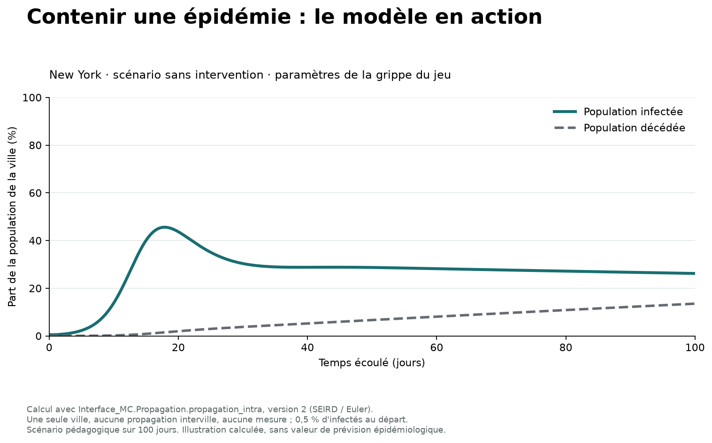

# Jeu de stratégie : contenir une épidémie

**Limiter la propagation d'un virus entre des villes en arbitrant entre mesures sanitaires, budget et popularité.**

Projet informatique collectif réalisé à l'INSA Lyon, en équipe de cinq étudiants. Le jeu associe un modèle de propagation à une interface graphique au tour par tour.

**Python · Tkinter · NumPy · Matplotlib · Pillow · programmation orientée objet · MVC**



Cet aperçu montre un scénario numérique dans une seule ville, sans mesures ni propagation entre villes. Ce n'est pas une capture de l'interface. Le script `docs/generer_apercu.py` permet de le régénérer.

## Principe du jeu

Une ville est contaminée au début de la partie. Le joueur choisit des mesures locales, investit dans la recherche d'un vaccin et décide du nombre de jours écoulés à chaque tour. La propagation et les ressources sont alors actualisées.

- Carte interactive et informations sur les villes.
- Modèle à compartiments **SEIRD** : susceptibles, exposés, infectés, rétablis et décédés.
- Propagation au sein des villes et entre les villes du réseau.
- Mesures sanitaires et économiques avec coûts et délais d'activation.
- Suivi du budget, de la popularité, des populations touchées et de la recherche vaccinale.
- Outils d'analyse par ville : coefficients effectifs des mesures, courbes de propagation et carnet de bord.

Voir [le guide du jeu](docs/guide-du-jeu.md) pour le déroulement d'une partie et les conditions de victoire.

## Conception et optimisation

Le projet comprend une évolution du découpage MVC, une hiérarchie de mesures et une étude de complexité de la propagation. La seconde version remplace les recherches répétées de positions dans les listes par des indices de matrice pré-calculés.

Le rapport compare les versions selon le nombre de villes, la durée simulée et les virus. Il met en évidence des compromis entre coût de calcul et précautions numériques, ainsi que des limites sur les grands réseaux.

Voir [la conception et l'optimisation](docs/conception-et-optimisation.md) et [le rapport universitaire original](docs/rapport-projet.pdf).

## Ma contribution et l'équipe

**Robin PLACE : contribution transversale au développement de l'application**, dans le cadre du travail collectif de l'équipe.

Le projet a été réalisé avec **Seymour LOI, Juliette Herr-Peyrot, Emilie LESOMMERE et Mai-Linh Duong**. La présence du dépôt sur mon profil ne constitue pas une attribution exclusive de ses fichiers.

## Installation et lancement

Environnement de référence : **Python 3.12**, avec Tkinter. Les versions utilisées pour la vérification sont fixées dans `requirements.txt`.

```sh
git clone https://github.com/Robin-Place/epidemic-strategy-game.git
cd epidemic-strategy-game
python -m venv .venv
```

Activer l'environnement avec `.venv\Scripts\Activate.ps1` sous PowerShell, ou `source .venv/bin/activate` sous Linux/macOS, puis :

```sh
python -m pip install -r requirements.txt
python lancer.py --check
python lancer.py
```

Les fichiers nécessaires sont `Worldcities - Données Villes 2.csv`, `Worldcities - Données Virus 3.csv` et `carte_monde.png`, à la racine du dépôt. Le lanceur signale les fichiers manquants. `--check` vérifie la présence des ressources et des modules ; il ne valide pas une partie complète.

**Les deux fichiers des villes ne sont pas interchangeables :** `Worldcities - Données Villes 2.csv` contient douze colonnes pour le jeu ; `Worldcities - Données Villes_2.csv` en contient quatre pour l'étude de complexité. Voir [les formats de données](docs/donnees.md).

Si Tkinter manque, vérifier son installation avec `python -m tkinter`. Il est fourni par l'installateur officiel Python pour Windows et peut nécessiter le paquet système `python3-tk` sous Linux.

## Organisation du code

- `Modele.py` : pays, villes, réseau, virus et mesures.
- `Vue.py` : carte, fenêtres et graphiques.
- `Controleur.py` : initialisation et règles de fin de partie.
- `Interface_MC.py` : propagation, monnaie et popularité.
- `Programme_principal.py` : lecture des données et assemblage.
- `ConvertisseurDeCoordonnees.py` : conversion des coordonnées géographiques.
- `Calculs_complexite.py` : script expérimental d'étude des temps de calcul.
- `test.py` : script historique de vérifications manuelles.
- `tests/` : tests automatisés du modèle.

Le découpage suit une organisation inspirée de MVC. Certaines dépendances entre logique et affichage demeurent.

## Vérifications et limites

```sh
python -m unittest discover -s tests -v
```

Les tests contrôlent les probabilités de connexion, les délais des mesures et l'effet des populations malades et décédées sur le revenu. Les données originales ne sont pas nécessaires à ces tests.

Le script historique `test.py` affiche des valeurs de contrôle ; il ne remplace pas une suite avec assertions. Le rapport conserve les mesures expérimentales du projet ; elles n'ont pas été reproduites lors de la préparation de cette version.

Ce jeu utilise un modèle pédagogique et des paramètres de jeu. Il ne constitue pas un outil de prévision épidémiologique. Les prolongements possibles sont la séparation plus complète entre modèle et interface, des scénarios reproductibles avec graine aléatoire et des tests couvrant des parties entières.

## Crédits et licence

Les auteurs du projet sont les cinq membres de l'équipe cités plus haut. `ConvertisseurDeCoordonnees.py` contient aussi la mention historique **`frindel`**, conservée dans le code.

Aucune licence de réutilisation n'a encore été choisie. Les droits et crédits du code, des données et de la carte doivent être précisés avant d'appliquer une licence commune. Voir [les crédits et la licence](docs/credits-et-licence.md).
